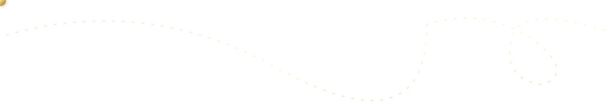

<div align="center">

<!-- Fluid Waving Gold & Obsidian Banner -->


<!-- Marauder's Inscription Ticker -->


<br/>

<!-- Crest Seals -->
<a href="https://github.com/lakkshyajhaaa"></a>
&nbsp;
<a href="#-the-restricted-section--specimen-archives"></a>
&nbsp;
<a href="https://linkedin.com/in/lakkshya-jha"></a>

</div>

---

### 🏛️ THE DEPARTMENT OF MYSTERIES · ARITHMANCY CHAMBER

<table border="0" width="100%">
<tr>
<td width="38%" align="center" valign="middle">
  <!-- Rotating 4D Hypercube integrated as the Arithmancy Core -->
  
</td>
<td width="62%" valign="middle">

```text
CLASSIFICATION :: TOP-SECRET // ARITHMANCY FELLOWSHIP
DISCIPLINE     :: Applied Mathematics & Uncertainty Calibration
SANCTUARY      :: Thapar Institute of Engineering & Technology
```

> *"Most models hallucinate with absolute certainty. True intelligence is knowing the precise geometric boundary of one's own ignorance."*

Grounding deep learning in mathematical rigor: linear algebra, optimization landscapes, probability theory, and local-first systems architecture.

</td>
</tr>
</table>

---

### 🗝️ THE RESTRICTED SECTION · SPECIMEN ARCHIVES

<table border="1" bordercolor="#D4AF37" bgcolor="#0A0A0A" width="100%">
<tr>
<td width="50%" valign="top" style="padding:16px;">

#### 🔮 SPECIMEN [01] :: PRAJNA-0.0
**`UNCERTAINTY-AWARE MACHINE VISION`**  
*Deep Learning · ResNet18 · Epistemic Calibration*

```python
signals   = ["Entropy", "Margin", "Certainty"]
decisions = {"ACCEPT": "Autonomous", 
             "REVIEW": "Summon Auror", 
             "REJECT": "Purge"}
```
> Enchants neural vision with humility. Calibrates confidence margins before high-stakes decisions are finalized.

</td>
<td width="50%" valign="top" style="padding:16px;">

#### 📜 SPECIMEN [02] :: ln(e)
**`LOCAL-FIRST KNOWLEDGE OPERATING LAYER`**  
*TypeScript · Offline AST · Graph Theory*

```typescript
const Vault = {
  storage: "Local-First Markdown",
  sync: "Zero-Cloud Siphoning",
  graph: "Bidirectional Knowledge AST"
};
```
> A rejection of cloud-rented thinking. Self-sovereign workspace keeping knowledge private on local silicon.

</td>
</tr>
<tr>
<td width="50%" valign="top" style="padding:16px;">

#### 🛡️ SPECIMEN [03] :: PRAJNA-SECURE-ID
**`ANTI-POLYJUICE OFFLINE WARD`**  
*Edge AI · Passive Liveness Detection*

* **Defense:** Verifies true biological presence on edge hardware.
* **Privacy:** Complete offline isolation. Biometric signatures never broadcast to remote servers.

</td>
<td width="50%" valign="top" style="padding:16px;">

#### 🧠 SPECIMEN [04] :: THE AI TWIN
**`THE COGNITIVE PENSIEVE`**  
*In Fermentation · Behavioral Modeling*

* **Architecture:** Synthesizing memory graphs to simulate counterfactual decisions and adaptive workflows.

</td>
</tr>
</table>

---

### ⚡ THE SEEKER'S FLIGHT PATH & COMMIT LEDGER

<div align="center">

<!-- The Live Flying Snitch (Swooping loop-de-loop across the screen) -->


<p><em>"The Snitch darts across the pitch, executing a loop and diving into the contribution ledger."</em></p>

<!-- Live 52-Week GitHub Contribution Grid in Gringotts Gold -->
<a href="https://github.com/lakkshyajhaaa">
  
</a>

</div>

---

### 🧪 THE ALCHEMICAL INVENTORY

<div align="center">

<p><b>✨ Divination & Applied Arithmancy</b></p>


<br/><br/>

<p><b>⚡ Transfiguration & Web Sorcery</b></p>


<br/><br/>

<p><b>📜 The Great Archives & Local Vaults</b></p>


</div>

---

### 📜 AUROR TELEMETRY · PERFORMANCE RECORDS

<div align="center">

<table border="0" width="100%">
<tr>
<td width="50%" align="center">
  
</td>
<td width="50%" align="center">
  
</td>
</tr>
</table>

</div>

---

### 🦉 DISPATCH VIA FLOO NETWORK

<div align="center">

```text
The Floo Network is open for research fellowships, mathematical discussions,
and collaborations on uncertainty-aware autonomous systems.
```

<br/>

<a href="https://github.com/lakkshyajhaaa">
  
</a>
&nbsp;&nbsp;
<a href="https://linkedin.com/in/lakkshya-jha">
  
</a>
&nbsp;&nbsp;
<a href="mailto:your-email@example.com">
  
</a>

<br/><br/>

```text
               ⚡  △⃒⃘  ⚡
   "I solemnly swear that I am up to no good."
              · · ·
         Mischief Managed.
```

<!-- Fluid Waving Gold Footer Wave -->


</div>
